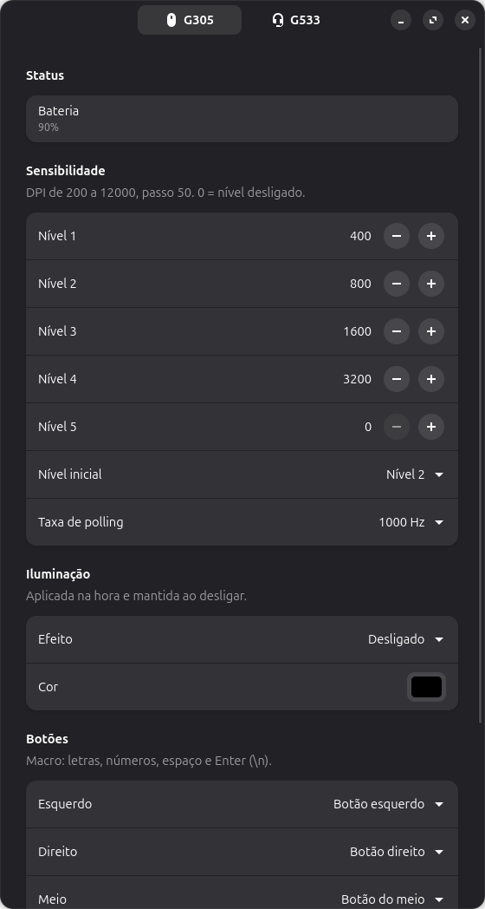
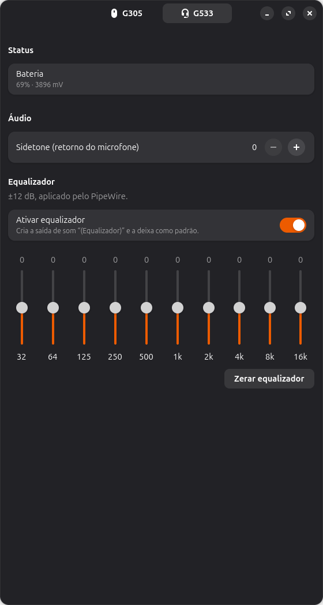

<p align="center"></p>

# Logibuntu

Configurador leve para mouses e headsets **Logitech G** no Ubuntu, uma alternativa ao G HUB (que não existe para Linux).

Ele fala **HID++ 2.0** direto com o dispositivo via `hidraw`: não tem daemon, não precisa de root, e as únicas dependências são Python 3 + GTK4/libadwaita, que já vêm no Ubuntu.

<p align="center">
  
  
</p>

## Funções

| Dispositivo | O que dá para fazer |
|---|---|
| **Mouse** | bateria, 5 níveis de DPI, nível inicial, taxa de polling (125–1000 Hz), remapear botões (mouse, DPI, mídia, atalhos), **macros de texto**, iluminação (desligado, cor fixa, respiração, ciclo) e restaurar o padrão de fábrica |
| **Headset** | bateria, sidetone (retorno do microfone) e equalizador de 10 bandas |

As configurações do mouse ficam **gravadas na memória dele**, como o modo "memória integrada" do G HUB. Elas valem em qualquer PC, sem o app aberto.

Testado com o **G305 Lightspeed** e o **G533**. Outros modelos com HID++ 2.0 (perfis onboard `0x8100`, DPI `0x2201`) devem funcionar, mas ainda não foram testados. Se você testar, abra uma issue com a saída de `python3 probe.py`.

## Instalação

Baixe o `.deb` mais recente em **[Releases](https://github.com/simonscabello/logibuntu/releases/latest)** e instale:

```sh
sudo apt install ./logibuntu_*_all.deb
```

Depois abra **Logibuntu** pelo menu de aplicativos. Se o dispositivo já estava conectado e não aparecer, desconecte o receptor e conecte de novo.

Requer Ubuntu 24.04 ou mais novo (GTK 4.10+, libadwaita 1.4+).

### A partir do código

```sh
git clone https://github.com/simonscabello/logibuntu && cd logibuntu
./install.sh          # regra udev (pede sudo) + atalho no menu
python3 -m logibuntu
```

## Como funciona

- **Permissão:** a regra `70-logibuntu.rules` dá acesso aos nós `hidraw` da Logitech (vendor `046d`) para quem está logado, via `uaccess`. O prefixo precisa ser menor que `73` para o `uaccess` funcionar.
- **Mouse:** o perfil é gravado no setor de usuário da memória onboard, com CRC e verificação por releitura. O perfil de fábrica fica na ROM, então "Restaurar padrão" sempre funciona.
- **Equalizador:** o G533 aceita EQ por HID++, mas não o aplica no áudio. Por isso o EQ é uma saída de som virtual do PipeWire, "G533 (Equalizador)", definida em `~/.config/pipewire/pipewire.conf.d/logibuntu-eq.conf`. Ligar ou desligar reinicia o PipeWire uma vez (cerca de 1 s sem som).

Diagnóstico: `python3 probe.py` lista os dispositivos e os recursos HID++ de cada um. Testes: `python3 -m unittest discover tests`.

## Limites

- As macros digitam letras, números, espaço e Enter (`\n`). Símbolos e acentos não funcionam, porque dependem do layout do teclado.
- A porcentagem da bateria do headset é estimada pela tensão.
- Se o fone estiver desligado quando você entrar no Ubuntu, a saída "(Equalizador)" fica sem destino até ele ligar.

## Gerar uma versão

```sh
git tag v0.2.0 && git push origin v0.2.0   # o GitHub Actions roda os testes, gera o .deb e publica a release
```

---

Projeto independente, sem nenhuma relação com a Logitech. "Logitech", "G HUB" e os nomes dos produtos são marcas da Logitech International S.A.

Licença: [MIT](LICENSE).
